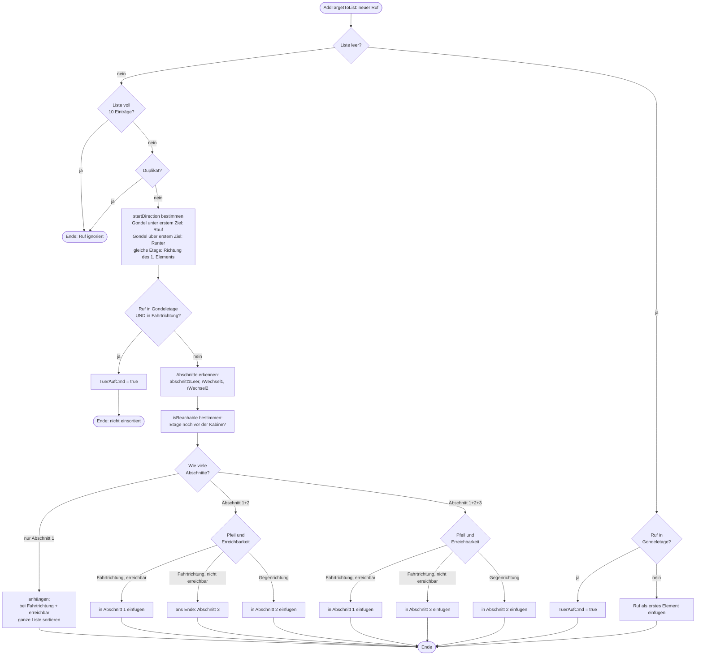

# Bericht: Ablauf von `AddTargetToList` (main.cc, Stand 5.11.2026, 14:48)

Notation: `U5` = Ruf in Etage 5, Richtung hoch (Up). `D3` = Ruf in Etage 3, Richtung runter (Down). Etage 1 = EG.

## 1. Aufgabe der Funktion

`AddTargetToList(newElement, TargetList, gondelPosition, TuerAufCmd)` wird bei jedem gedrückten Taster aufgerufen
(auch mehrfach, solange er gedrückt bleibt). Sie sortiert den neuen Ruf so in die Zielliste ein, dass die Kabine

1. zuerst alle erreichbaren Rufe **in der aktuellen Fahrtrichtung** abfährt,
2. danach die Rufe der **Gegenrichtung**,
3. zuletzt die Rufe in Fahrtrichtung, die **nicht mehr erreichbar** sind (die Kabine ist schon vorbei).

Die Liste ist also immer in bis zu drei **Abschnitte** gegliedert. Das erste Element ist das aktuelle Ziel.
Nach jedem erreichten Stockwerk wird es (später) gelöscht.

## 2. Bausteine

| Baustein | Aufgabe |
|---|---|
| `Target` | `level` (1 = EG) und `direction` (`Rauf` / `Runter`) |
| `SortBetweenLimits(lo, hi, Liste, dir)` | Insertion Sort der Elemente `lo..hi` nach Etage. `dir = true` aufsteigend, `false` absteigend |
| `InsertBetweenLimits(neu, lo, hi, Liste, dir)` | Fügt `neu` hinter Index `hi` ein und sortiert den Abschnitt `lo..hi+1` mit `SortBetweenLimits` |
| `AddTargetToList` | Entscheidet, in welchen Abschnitt der Ruf gehört (siehe unten) |

## 3. Ablauf in Worten

**Schritt 1: Vorprüfungen (Abbruch ohne Einfügen)**

1. **Liste leer:** Liegt der Ruf in der Gondeletage, wird `TuerAufCmd = true` gesetzt und nichts eingefügt. Sonst wird der Ruf als erstes Element eingefügt. Ende.
2. **Liste voll** (10 Einträge, Größe des ST-Arrays): Ruf wird ignoriert. Ende.
3. **Duplikat:** Der Ruf steht schon in der Liste (gleiche Etage und Richtung): ignorieren. Ende. (Wichtig, weil ein gedrückter Taster die Funktion jeden Zyklus neu aufruft.)

**Schritt 2: Fahrtrichtung bestimmen (`startDirection`)**

Sie ergibt sich aus Gondelposition und **erstem Ziel**, nicht aus dem Pfeil des ersten Rufs:

| Lage | `startDirection` |
|---|---|
| Gondel liegt unter dem ersten Ziel | `Rauf` |
| Gondel liegt über dem ersten Ziel | `Runter` |
| Gondel steht in der Etage des ersten Ziels | Richtung des ersten Elements |

**Schritt 3: Ruf in der Gondeletage**

Liegt der neue Ruf in der Gondeletage **und** zeigt in Fahrtrichtung: `TuerAufCmd = true`, nicht einsortieren, Ende.
(Ein Ruf in Gegenrichtung wird normal einsortiert, die Kabine kommt später zurück.)

**Schritt 4: Abschnitte der bestehenden Liste erkennen**

- `abschnitt1Leer`: Hat das **erste** Element einen Pfeil gegen die Fahrtrichtung, ist Abschnitt 1 leer. Beispiel: Gondel 6, Liste `U5` (Fahrt runter, `U5` ist Gegenrichtung).
- `rWechsel1` = Index des **letzten** Elements von Abschnitt 1. Gesucht wird ab Index 1 das erste Element, das entweder einen anderen Pfeil hat oder die Etagen-Sortierung bricht. Dann ist `rWechsel1 = i-1`.
- `wechsel1` = es gibt einen ersten Richtungswechsel (`rWechsel1 != -1` oder `abschnitt1Leer`).
- `rWechsel2` = Index des **ersten** Elements von Abschnitt 3 (erstes Element hinter dem Wechsel, dessen Pfeil wieder in Fahrtrichtung zeigt). `-1`, wenn es keinen Abschnitt 3 gibt.

**Schritt 5: Ist der neue Ruf noch erreichbar? (`isReachable`)**

Erreichbar heißt: Die Kabine hat die Etage noch vor sich.
Bei `Runter`: Etage des Rufs liegt **unter** der Gondel. Bei `Rauf`: Etage liegt **über** der Gondel.

**Schritt 6: In den richtigen Abschnitt einfügen**

| Fall | Neuer Ruf | Wohin | Sortierung |
|---|---|---|---|
| Kein Wechsel (nur Abschnitt 1) | in Fahrtrichtung, erreichbar | ans Ende anhängen, ganze Liste sortieren | Fahrtrichtung |
| | sonst | ans Ende anhängen | (kein Sortieren nötig) |
| Ein Wechsel (Abschnitt 1 + 2) | in Fahrtrichtung, erreichbar | in Abschnitt 1 (`0..rWechsel1`) | Fahrtrichtung |
| | in Fahrtrichtung, nicht erreichbar | ans Ende (wird Abschnitt 3) | - |
| | Gegenrichtung | in Abschnitt 2 (`rWechsel1+1..Ende`) | entgegen der Fahrtrichtung |
| Zwei Wechsel (Abschnitt 1 + 2 + 3) | in Fahrtrichtung, erreichbar | in Abschnitt 1 | Fahrtrichtung |
| | in Fahrtrichtung, nicht erreichbar | in Abschnitt 3 (`rWechsel2..Ende`) | Fahrtrichtung |
| | Gegenrichtung | in Abschnitt 2 (`rWechsel1+1..rWechsel2-1`) | entgegen der Fahrtrichtung |

## 4. Flussdiagramm

## 5. Durchgerechnetes Beispiel

**Gondel 6, Liste `U5`, neuer Ruf `D4`.**

1. Liste nicht leer, nicht voll, kein Duplikat.
2. Gondel (6) liegt über dem ersten Ziel (5): `startDirection = Runter`.
3. `D4` liegt nicht in der Gondeletage.
4. Das erste Element (`U5`) hat Pfeil `Rauf`, also gegen die Fahrtrichtung: `abschnitt1Leer = true`, `rWechsel1 = -1`, `wechsel1 = true`. Es gibt kein weiteres Element: `rWechsel2 = -1`.
5. `D4` liegt unter der Gondel und zeigt nach unten: erreichbar, Pfeil gleich Fahrtrichtung.
6. Fall „ein Wechsel", Fahrtrichtung + erreichbar: Einfügen in `0..rWechsel1` = `0..-1`, also ganz vorn.

Ergebnis: **`D4 U5`**. Die Kabine fährt zuerst von 6 nach unten und hält bei 4. Dann kehrt sie um und hält bei 5.

## 6. Prüfstand

Geprüft mit: 241 Szenarien, 5 Zufallsläufe zu je 100.000 Wiederholungen, 20 Gruppentests (`test.cc`).

- Gruppentests: 20 von 20 bestanden.
- Zufallstests: keine Abweichungen von der Referenz, keine verpassten Mitnahmen, keine verlorenen Rufe.
- Meine 241 Szenarien: 51 Fehlschläge. Sie betreffen nur den Fall „Gondel im Stockwerk des ersten Ziels". Mein Test erwartet dort noch das alte Verhalten (`TuerAufCmd`, nicht einsortieren). Der Code fügt den Ruf jetzt ein. Das sind keine Reihenfolge-Fehler.
- Compiler: keine Warnung zu nicht initialisierten Variablen mehr.

## 7. Offene Punkte

- **Gondel im Stockwerk des ersten Ziels:** `startDirection` ist jetzt die Richtung des ersten Elements. Ob das fachlich passt (zum Beispiel, wenn nach dem Türschluss die Richtung neu festgelegt wird), müsst ihr entscheiden.
- **Hinweis:** Die Funktion arbeitet mit `std::vector`. Für ST muss das auf ein Array mit 10 Plätzen und `GetArray`/`PutArray`/`InsertArray` abgebildet werden. Die Logik selbst nutzt nur `for`/`if` und lässt sich 1:1 übertragen.
- **`isReachable` vergleicht mit `!startDirection`:** Das funktioniert, weil `Runter = 0` und `Rauf = 1` ist. In ST besser explizit als `startDirection = FALSE` bzw. `TRUE` schreiben.
